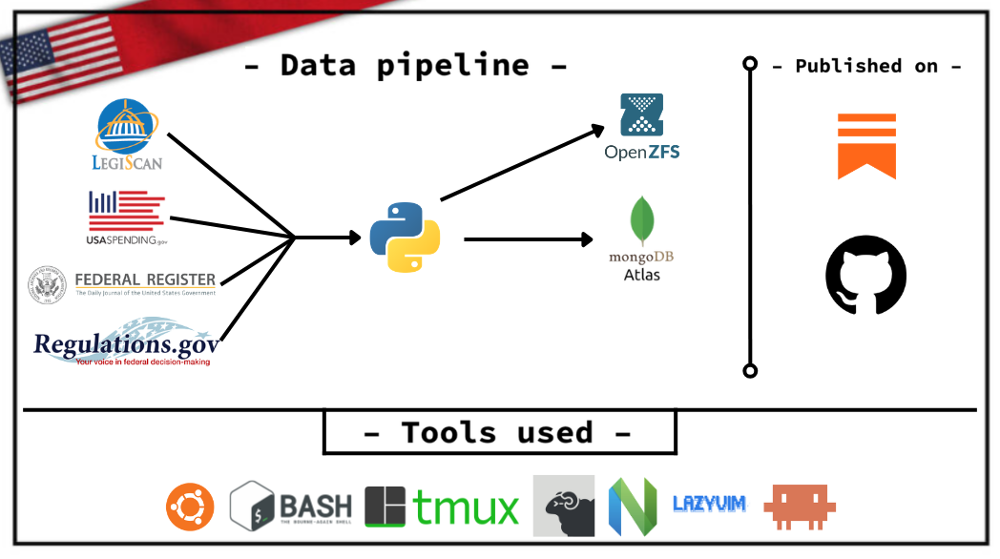

# UAS Project | Weekly API -> PostgreSQL Data Pipeline and Analysis  


**Table of Contents** <br> 
- [Data Sources](#data-sources)
  - [LegiScan API](#legiscan-api)
  - [USASpending API](#usaspending-api)
  - [Federal Register API](#federal-register-api)
  - [Regulations API](#regulations-api)
- [Repository Layout](#repository-layout)
- [How it works](#how-it-works)
  - [Overview / Architecture](#overview--architecture)
  - [Scheduling](#scheduling)
  - [Pre-run checks](#pre-run-checks)
  - [Backups and restore](#backups-and-restore)
  - [Ingest](#ingest)
  - [Policies and Tracks](#policies-and-tracks)
  - [Data Model](#data-model)
  - [Validation](#validation)
  - [Outputs](#outputs)
- [Live Database](#live-database)
- [My Building Process](#my-building-process)
- [What's Planned Next](#whats-planned-next)
- [Data Safety](#data-safety)
  - [Backups and Recovery](#backups-and-recovery)
  - [Secrets and Access](#secrets-and-access)
  - [API Terms](#api-terms)
<br> <br>
## Data Sources

To track federal UAS policy, I am using a combination of the LegiScan API and multiple government-based sources. The tracker's focus is **defense drones: policy and procurement** -- the NDAA and defense appropriations, limits on foreign-made drones, DoD drone programs and the domestic industrial base, with contract data as the market evidence. More info on how I use each source can be found in [How it works](#how-it-works).

### LegiScan API

I am using my free tier of LegiScan's Public API to source legislative data. The API covers both federal and state level legislative data, and I am using only the data on US Congress.

**Simplified pipeline:**

1. Query the **`getDatasetList`** endpoint for the dataset_hash and the access_key to the getDatasetRaw endpoint. LegiScan terms require that I download data from getDatasetRaw only when the dataset_hash has changed.
2. Query **`getDatasetRaw`** for a compressed zip of JSON files (one file per bill). A bill is kept if its title or description mentions a drone keyword, or if it is one of the must-pass defense bills: the **National Defense Authorization Act** and **Department of Defense Appropriations Act** for each fiscal year (these carry drone provisions without saying so in the title). Every kept bill is saved as a weekly snapshot in **`bill_snapshots`**, and its row in **`bills`** is only updated when its change_hash differs from last week's.

**Code:** The code for my LegiScan API request and Postgres ingest can be found in [legiscan_loader.py](https://github.com/WalkerSimpson1/UAS_Project/blob/main/scripts/legiscan_loader.py).

### USASpending API

I use multiple endpoints from the USASpending API to compile contract data. Specifically, I am gathering data on contracts with the Product Service Code (PSC) of 1550. This is the code for Unmanned Aircraft. Counter-drone work is mostly bought under research and engineering codes instead, so a second search finds counter-UAS awards by keyword across every PSC code. The USASpending API requires no account or API key. It must be noted that contract data comes from the Federal Procurement Data System, which is subject to delays of different times (DoD posts about 90 days late).

**Endpoints (all POST):**

1. **`/search/spending_by_transaction/`** -- For individual transactions within contracts. This endpoint discovers which contracts had activity in the past two weeks.
2. **`/search/spending_by_award/`** -- For whole contracts. This endpoint gives contract level details, such as recipient, agencies, total amounts, NAICS code, and dates. I call it twice: once for PSC 1550, and once with counter-UAS keywords ("counter-UAS", "C-UAS", "counter-unmanned", ...) and no PSC filter. Keyword results are stored with `source = 'keyword_search'` and kept out of the PSC 1550 totals.
3. **`/transactions/`** -- This returns one contract's transaction history. I use it to fetch the history of contracts found in step 1. I also use it to fetch history of awards whose last modified date is within the last week, but did not have a new transaction recorded.
4. **`/download/awards/`** and **`/download/transactions/`** -- Bulk CSV downloads of a whole fiscal year, used by `backfill.py contracts --fy <year>` for complete market totals. FY2020–FY2026 are loaded.

**Code:** The code for my USASpending requests and Postgres ingest can be found in [usaspending_loader.py](https://github.com/WalkerSimpson1/UAS_Project/blob/main/scripts/usaspending_loader.py).

### Federal Register API

I use the Federal Register API to gather last week's new rules, proposed rules, notices, and presidential documents. This API requires no account or API key, and returns JSON.

**Endpoint (GET):**

1. **`/api/v1/documents.json`** -- The most important params are my six keywords: ("unmanned aircraft", "unmanned aerial", "drone", "counter-UAS", "UAS", and "advanced air mobility"). Different keywords can return the same data points, so results with matching ids are dropped.

The keyword search is full text, so "drone" anywhere in a 200-page notice is a match. A document is kept only if a keyword is in its **title or abstract**, or if it comes from **DoD, the Bureau of Industry and Security, OFAC, or USTR** (their drone rules, Entity List additions, arms sales and tariff actions often don't say "drone" in the title). Coast Guard drone-show safety zones, advisory-committee meetings and environmental impact statements are dropped as noise.

**Code:** The code for my Federal Register requests and Postgres ingest can be found at [federal_register_loader.py](https://github.com/WalkerSimpson1/UAS_Project/blob/main/scripts/federal_register_loader.py).

### Regulations API

I use the Regulations API to gather docket comments. Dockets are spaces dedicated to a rule, from proposed rulemaking -> interim rule -> final rule. Through a rulemaking's life cycle, members of the public comment their opinions on its docket. This is a great source to determine the stance of different key actors - such as business owners, manufacturers, hobbyists, etc.

The Regulations.gov API is special because it is the only one that depends on another API's output, this being the Federal Register API. This API does require an account, which is free, and returns JSON. The API key comes from [api.data.gov](https://api.data.gov/signup/).

**Endpoints (all GET):**

1. **`/documents?filter[docketId]=<docket>`** -- Used to link the regulations.gov dockets to Federal Register documents by frDocNum. Docket IDs are read from the Federal Register documents kept that week (e.g. `FAA-2025-1908`).
2. **`/comments?filter[commentOnId]=<objectId>&sort=-lastModifiedDate`** -- This endpoint lists the comments on an individual document. It writes to `regulatory_comments` with the title, posted date, and agency. The docketId is copied from the parent document.
3. **`/comments/{commentId}`** -- This endpoint gets the detail for an individual comment. It writes the organization, submitter_name, and comment_text. It's limited to 300 per weekly run, newest first, across all dockets.

**Code:** The code for my Regulations API request and Postgres ingest can be found at [regulations_loader.py](https://github.com/WalkerSimpson1/UAS_Project/blob/main/scripts/regulations_loader.py).

## Repository Layout

```text
UAS_Project/
├── docker-compose.yml             # Postgres 18 (127.0.0.1:5432, data in the pgdata volume)
├── .env.example                   # Copy to .env: API keys, Postgres settings, RAW_ROOT
├── requirements.txt               # Pinned Python dependencies (installed into .venv/)
├── CLAUDE.md                      # Guidance for Claude Code
├── README.md
├── Exported_SQL_*.csv             # Old MongoDB-era CSV exports (no longer updated)
│
├── db/migrations/                 # Numbered SQL files, applied in order by db_migrate.py
│   ├── 001_core.sql               # Source tables (bills, documents, comments, contracts, runs)
│   ├── 002_analysis.sql           # Policies, tracks, events, analyses; review views
│   ├── 003_tracks_seed.sql        # First tracks and their matching rules
│   ├── 004_ai_fields.sql          # AI draft columns
│   └── 005–008_*.sql              # Defense track, counter-UAS award source, trade-control rules
│
├── scripts/                       # Pipeline (run from repo root with .venv/Scripts/python)
│   ├── weekly_run.py              # Weekly entry point: checks → backup → loaders → sync → drafts
│   │                              #   → validate → export → backup
│   ├── install_task.ps1           # Registers the Windows Task Scheduler task
│   ├── pg_common.py               # Shared config, connect(), RawStore, upsert, date helpers
│   ├── db_migrate.py              # Applies db/migrations/*.sql
│   ├── legiscan_loader.py         # LegiScan → bill_snapshots, bills
│   ├── usaspending_loader.py      # USASpending → contract_activity_feed, contract_awards,
│   │                              #   contract_transactions
│   ├── federal_register_loader.py # Federal Register → regulatory_documents (fr:)
│   ├── regulations_loader.py      # Regulations.gov → regulatory_documents (rg:), regulatory_comments
│   ├── sync_policies.py           # Source rows → policies, policy events, tracks
│   ├── summarize.py               # AI first drafts with claude -p (private, for my review)
│   ├── export_site.py             # Dashboard data → site/data/*.json
│   ├── export_public_db.py        # Public SQLite copy + recommended queries → site/data/
│   ├── backfill.py                # Manual backfills: Federal Register, dockets, bulk contracts
│   └── migrate_mongo_to_pg.py     # One-time: MongoDB → Postgres migration (done)
│
├── site/                          # GitHub Pages: weekly analytics dashboard + SQL queries
│   ├── index.html
│   ├── query.html                 # Redirects to index.html#query
│   └── data/                      # Weekly JSON + uas_public.db (SQLite)
│
├── .github/workflows/pages.yml    # Deploys site/ on every push to main
│
├── analysis/
│   └── USASpending_Past_Visualizations.ipynb   # Read-only obligation/competition charts
│
├── docs/
│   ├── DECISIONS.md               # Design decisions P1+ and open questions
│   ├── format.md                  # Publishing format: track pages, policy pages, dashboard
│   ├── research/                  # Background research notes
│   ├── mongodb_schema.md          # MongoDB-era schema and decisions D1–D21 (history)
│   └── api_documentation/         # Reference copies of each source's API docs
│       ├── LegiScan_API_User_Manual.md
│       ├── LegiScan_API_Crash_Course.md
│       ├── Federal_Register_API_v1.md
│       ├── Regulations_gov_API_v4.md
│       ├── spending_by_award.md
│       ├── spending_by_award_count.md
│       ├── spending_by_transaction.md
│       └── transactions.md
│
└── usa_spending_old_data/         # USASpending bulk downloads, PSC 1550, FY2020–2025
    ├── base_awards/               # psc1550_fy20XX.csv
    └── transactions/              # psc1550_fy20XX_t.csv
```

Outside git (`data/`, gitignored):

```text
data/
├── raw/                           # Write-once raw API responses ($RAW_ROOT), indexed in raw_files
│   ├── legiscan/<dataset_date>/
│   ├── usaspending/
│   ├── federal_register/<run_date>/
│   └── regulations_gov/<run_date>/
├── backups/                       # pg_dump archives
├── logs/                          # weekly-<date>.log
└── ai/                            # Working folder for claude -p
```

## How it works
### Overview / Architecture
Data is gathered from multiple endpoints of the LegiScan API, the USASpending.gov API, the FederalRegister.gov API, and the Regulations.gov API. <br>
↓ <br>
This data feeds into one PostgreSQL 18 database, running in Docker on my Windows laptop. <br>
↓ <br>
The pipeline groups new and changed items into **policies**, sorts them into **tracks**, and drafts a first-pass summary of each for me to review. <br>
↓ <br>
Each week it publishes a small analytics dashboard and a public, queryable copy of the database on GitHub Pages. The tracker itself, my written analysis, lives on Substack. <br>
<br>
I started on MongoDB because I covered it in my Databases class at LSE and had a MongoDB certification course through the GitHub Student Developer Pack. In November 2026 I moved to **PostgreSQL**: the data is relational (bills ↔ policies ↔ tracks ↔ contracts), SQL is what most business and government analytics teams use, and Docker keeps the setup to one command. The MongoDB-era design is kept in `docs/mongodb_schema.md`.

### Scheduling
The weekly run (`scripts/weekly_run.py`) is started by Windows Task Scheduler. The task is registered once with `scripts/install_task.ps1`:

```powershell
$daily = New-ScheduledTaskTrigger -Daily -At 7pm
$logon = New-ScheduledTaskTrigger -AtLogOn -User $env:USERNAME
$logon.Delay = "PT10M"
$settings = New-ScheduledTaskSettingsSet -StartWhenAvailable -RunOnlyIfNetworkAvailable
```

The task fires every day, but the script exits right away if a weekly run succeeded in the past 6 days. My laptop isn't always on, so this means a missed Sunday is caught up the next time it is. After a gap, each loader widens its lookback window to cover the missed days.

**One-time setup command:** `powershell -ExecutionPolicy Bypass -File scripts\install_task.ps1 -Publish` <br>
`-Publish` lets the run commit and push the dashboard data to GitHub.

**Useful Commands:**
1. **Next run time** -- `Get-ScheduledTaskInfo -TaskName "UAS weekly"`
2. **Run now** -- `Start-ScheduledTask -TaskName "UAS weekly"` (or `.venv/Scripts/python scripts/weekly_run.py --force`)
3. **Status of last run** -- `Get-ScheduledTaskInfo -TaskName "UAS weekly"` (LastTaskResult: 0 ok, 2 warnings, 1 failed)
4. **View the run's log** -- `data/logs/weekly-<date>.log`

### Pre-run checks
Before any backup is taken or any data changes, `weekly_run.py` checks that everything a run depends on is in its place.

The script runs in the order: <br>
start Postgres -> skip check -> API keys -> network -> backup

- **Start Postgres** runs `docker compose up -d --wait postgres`. If Docker Desktop isn't running, the run stops here and tries again at the next trigger.
- **Skip check** reads the `runs` table. If a weekly run succeeded in the past 6 days it exits; otherwise it computes the gap and how far back each loader should look.
- **API keys** checks that `LEGI_API_KEY` and `REGULATIONS_API_KEY` are set in `.env`.
- **Network** connects to `api.usaspending.gov` and `www.federalregister.gov`.
- `--dry-run` stops after these checks and prints what the run would do.

### Backups and restore
Each run takes two `pg_dump` backups through Docker (`docker compose exec postgres pg_dump -Fc`):
1. **`data/backups/pre-<date>.dump`** -- taken right before the loaders run.
2. **`data/backups/uas_tracker_<date>.dump`** -- taken at the end of a successful run.

Every write is an upsert, so a run that fails halfway leaves only complete, valid rows, and re-running it is safe. That is why a failure keeps the data instead of rolling back automatically. If I do need to undo a run, the log prints the restore command for that run's pre dump:

```bash
docker compose exec -T postgres sh -c 'pg_restore -U "$POSTGRES_USER" -d "$POSTGRES_DB" --clean --if-exists' < data/backups/pre-<date>.dump
```

The raw API files are write-once and indexed in the `raw_files` table, so the database can also be rebuilt from them.

### Ingest
After the pre-run backup, `weekly_run.py` runs the four loader scripts: `legiscan_loader.py`, `usaspending_loader.py`, `federal_register_loader.py`, and `regulations_loader.py`. Each loader saves the raw response to `data/raw` first, then upserts into Postgres. Each loader writes its own `runs` row, and `weekly_run.py` writes a parent row linking the four. Within USASpending, each step runs in its own transaction, so one failed step doesn't undo the others.

### Policies and Tracks
The loaders only fill source tables. `sync_policies.py` then turns them into things worth analyzing:

1. **Policies** -- One policy per thing I'd write about. Companion House and Senate bills merge into one policy by title. Federal Register and Regulations.gov documents group by shared docket, RIN or FR document number, so a rulemaking's NPRM, comment extensions and final rule sit together. Recurring notices with no docket (DoD arms-sales notifications) group into one policy.
2. **Events** -- What changed and when: a new bill, a status change, new text, a new document in a rulemaking, a comment period, new public comments. Items found long after they happened (backfills) are linked without an event, so the weekly view shows only what's new.
3. **Tracks** -- Loose groupings, matched by title and agency rules stored in `track_rules`. A policy can be in more than one. The **active** track is **Defense drones: policy and procurement**; BVLOS and airspace, counter-UAS authority and public safety are a watch list.
4. **AI drafts** -- `summarize.py` asks Claude (`claude -p` on my subscription, no tools, a fixed JSON schema) for a first-pass summary, stakeholder list and firm implications of each new active-track policy, using only a fact sheet built from the database. Drafts stay private: they are a starting point for my own analysis, not something I publish.

### Data Model
Everything lives in my `uas_tracker` Postgres database. The schema is in `db/migrations/`.

Per policy area:

**Legislation:** `bill_snapshots` is an append-style table, getting a new photo of every bill weekly and keeping the old photos. Comparatively, `bills` updates a bill's API fields when it has a new `change_hash`, signalling there was an update.

**Rules:** The `regulatory_documents` table holds Federal Register (`fr:`) and Regulations.gov (`rg:`) documents. Public comments are in `regulatory_comments`.

**Contracts:** `contract_transactions` holds transactions on awards the pipeline touched. `contract_awards` is a lookup of awards (PSC 1550, plus counter-UAS keyword matches), and `contract_activity_feed` is the 14-day discovery feed. `past_awards` and `past_transactions` are the complete bulk downloads, FY2020–FY2026 -- the only tables to use for market totals.

**Analysis:** `policies`, `policy_sources`, `policy_events`, `tracks`, `track_rules`, `policy_tracks` and `analyses` (AI drafts, my status and my Substack link). Two views drive my weekly review: `weekly_changes` and `review_queue`.

### Validation
Before the loaders run, `weekly_run.py` counts the rows in every source table. After the loaders and sync, it counts again and checks that:
1. **Nothing shrank** -- each source table has at least as many rows as before.
2. **Required tables are not empty** -- `bills` and `contract_awards` must hold at least one row, even if this week added nothing.
3. **Every loader finished** -- each of the four writes a `runs` row with its status, counts and errors, and a loader that fails marks the run failed.

If a check fails, the run is marked failed (exit code 1), the data is kept, and the log names the restore command. AI drafts and the dashboard export only produce warnings (exit code 2), since they don't change the source data.

### Outputs
Once validation passes, `weekly_run.py` produces three outputs and prunes old backups.
1. **Dashboard data:** `export_site.py` writes...
   - `summary.json`: headline numbers (policies tracked, changes this week, counter-drone awards)
   - `levers.json`: policies per lever in the active track
   - `themes.json`: policies per theme (tags; a policy can have several)
   - `obligations_by_fy.json`, `top_recipients.json`: PSC 1550 obligations by fiscal year and the top recipients of the latest year
2. **Public database:** `export_public_db.py` writes `uas_public.db` (SQLite) and `metadata.json` with recommended queries. See [Live Database](#live-database).
3. **Publish:** with `--publish`, the run commits `site/data` and pushes it to `main`, and the GitHub Actions workflow deploys `site/` to GitHub Pages.
4. **Prune:** keeps the last 12 end-of-run dumps and the last 2 pre-run dumps.

## Live Database
**The public database updates weekly, not in real time**

Every week, `export_public_db.py` copies the public tables from Postgres into one SQLite file, published with the dashboard. Nothing runs on a server: the queries run in your browser.

### Guide to querying  
<details>
<summary><b>Query the live database (read-only)</b></summary>

**Dashboard:** [walkersimpson1.github.io/UAS_Project](https://walkersimpson1.github.io/UAS_Project/) <br>
**Queries:** [walkersimpson1.github.io/UAS_Project/#query](https://walkersimpson1.github.io/UAS_Project/#query) -- recommended queries to copy, or run in your browser with Datasette Lite. <br>
**Download:** [uas_public.db](https://walkersimpson1.github.io/UAS_Project/data/uas_public.db) -- opens in any SQLite tool.

**sqlite3:**
```bash
sqlite3 uas_public.db
```

**Example queries:**
```sql
select fiscal_year, round(sum(federal_action_obligation) / 1e6, 1) as obligated_millions
from bulk_transactions group by fiscal_year order by fiscal_year;

select identifier, title, status_date, url from bills where status >= 2 order by status_date desc;
```

**Main tables:** `policies`, `policy_events`, `bills`, `bill_sponsors`, `regulatory_documents`, `regulatory_comments`, `bulk_transactions`, `contract_awards`

Not included: AI drafts, my notes, raw API payloads, and commenters' names (organizations are kept).

</details>

## My Building Process
Before automating the data collection and migrating to MongoDB in early October 2026, I had built this project manually in Python notebooks and SQLite/DB Browser. In November 2026 I moved it to PostgreSQL in Docker on my Windows laptop.

**Currently my building workflow consists of...** 
1. Editing CLAUDE.md in **Neovim (with the LazyVim distribution)** on the context and goals of my new feature.
2. Opening multiple Claude agents in **herdr**, often in individual git worktrees.
3. Prompting the Claude agents on the individual sections each handles. 
4. Reviewing the new code and Postgres compatibility in a **tmux** session with one pane in Neovim, another running psql, and another with Claude Code in the main branch to refer to what's in main. 
<br> <br>
**Wanted changes to my workflow**
1. I want to compile a set of the best/ideal prompts to use for specific situations with Claude Code.
2. I have installed the Claude Code Vibewise plugin and "Court of Claude" skill, which aim to reduce learning losses and AI agreeableness. Have yet to use them for serious building.
3. Using yazi to navigate API response and database files.

## What's Planned Next
**Apart from keeping up with the weekly updates and writing the defense track's analysis on Substack...**
1. Statistical analysis of the contract data: whether restrictions on foreign-made drones moved federal spending to domestic vendors, vendor concentration over time, and the share of dollars that are competed.
2. Quantitative text-based analysis of docket comments from regulations.gov.
3. Regression with contracts/transactions, linking contract locations to congressional district/state sponsor and co-sponsor likelihood.
4. Auto-updating Datawrapper charts on Substack, fed by CSVs from the weekly run.
5. An off-laptop backup for the database dumps and raw files.

## Data Safety
### Backups and Recovery
My data is kept in `pg_dump` archives in `data/backups` and in the write-once raw files in `data/raw`, both on my laptop. The public tables are also published weekly on GitHub Pages. More info in [Backups and restore](#backups-and-restore) and [Outputs](#outputs).

1. **Raw files are write-once** -- Every API response is saved to `data/raw` before it is loaded, so the database can be rebuilt from them.
2. **Re-running is safe** -- Every write is an upsert keyed on a real ID, so a re-run can't create duplicates.
3. **Known gap** -- The dumps and raw files do not have an off-laptop copy yet. GitHub only holds the public tables.

### Secrets and Access
1. **API keys** -- My keys and connection strings live in a gitignored `.env` and are never printed or logged. Errors go through `redact()` first. The Regulations.gov key is only sent in the `X-Api-Key` header.
2. **Localhost only** -- Postgres only listens on 127.0.0.1, not the network.
3. **Least privilege** -- The pipeline runs as my user, not as an administrator, and the scheduled task runs with limited rights.
4. **Kept out of git** -- The database, dumps and raw API responses are not committed. Only the public dashboard data and SQLite copy are.

### API Terms
1. **LegiScan** -- Their terms require that I only download the dataset when the dataset_hash has changed.
2. **Regulations.gov** -- The API allows 1000 requests per hour, so I fetch at most 300 comment details per run and stop early if the rate limit runs low.
